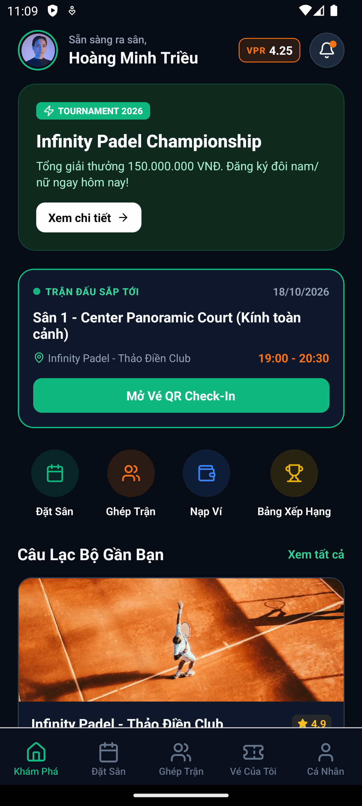

# Smart Court Management System
**Hệ thống quản lý và đặt sân thể thao thông minh, ứng dụng đa nền tảng**

* **Sinh viên thực hiện:** Võ Hữu Trí
* **MSSV:** 2380602326 - **Lớp:** 23DTHC7
* **Môn học:** CMP436 - Đồ án chuyên ngành CNTT

---

## 1. Câu định vị đề tài
> "Đồ án giải quyết tình trạng mất nhiều thời gian kiểm tra lịch trống thủ công qua Zalo/sổ tay và sai sót xếp trùng lịch đặt sân vào giờ cao điểm cho các chủ cụm sân thể thao tư nhân (Padel, Pickleball, bóng đá mini) và người chơi, đo bằng thời gian thao tác chốt một lịch đặt sân (phút) và số ca trùng lịch phát sinh mỗi tuần (ca/tuần)."

---

## 2. Bảng đo lường chỉ số Trước – Sau (W01)

*(Ghi chú: Theo quy định Tuần 1, cột **"Sau"** để trống chờ đo thực tế khi triển khai Pilot; cột **"Trước"** ghi số ước tính hiện trạng kèm kế hoạch đo thật).*

| Chỉ số | Cách đo | Trước (Hiện trạng & Kế hoạch đo) | Sau | Ngày đo "Trước" | Bằng chứng |
| :--- | :--- | :--- | :-: | :---: | :--- |
| **1. Thời gian chốt 1 lịch đặt sân** *(phút/lượt)* | Tính thời gian từ tin nhắn đầu tiên khách hỏi sân trên Zalo đến khi chủ sân tra sổ tay/Excel và nhắn xác nhận xong. | **Ước tính:** 15–30 phút/lượt. **Kế hoạch đo:** Lấy mẫu timestamp 15 đoạn chat Zalo khung giờ 17h–21h. | | 16/10 – 20/10/2026 | Ảnh chụp timestamp chat Zalo & bảng ghi chép tại `/docs/w01/`. |
| **2. Số ca trùng lịch đặt sân** *(ca/tuần)* | Đếm số lần 2 nhóm khách bị xếp trùng cùng 1 sân, cùng khung giờ trên sổ tay/Excel và tin nhắn phản ánh. | **Ước tính:** 2–4 ca/tuần. **Kế hoạch đo:** Rà soát sổ lịch sân và tin nhắn đổi giờ/xin lỗi khách trong 2 tuần gần nhất. | | 16/10 – 20/10/2026 | Ảnh chụp sổ lịch sân có vết gạch sửa & tin nhắn Zalo tại `/docs/w01/`. |

---

## 3. Làm rõ chi tiết quy trình đo Trước – Sau

### Chỉ số 1: Thời gian thao tác chốt 1 lịch đặt sân (Đơn vị: Phút/lượt)
* **Hiện trạng quy trình thủ công ("Trước"):** Khách nhắn Zalo hỏi giờ $\rightarrow$ Chủ sân mở sổ tay/Excel dò lịch trống $\rightarrow$ Nhắn báo khách $\rightarrow$ Khách chuyển khoản cọc và gửi ảnh biên lai $\rightarrow$ Chủ sân ghi tên vào sổ và xác nhận.
* **Cách đo "Trước" (Tuần 1 - Tuần 2):** Thu thập 15 cuộc hội thoại đặt sân thực tế trên Zalo của chủ sân, lấy mốc thời gian (timestamp) tin nhắn chốt sân cuối cùng trừ đi mốc thời gian tin nhắn hỏi đầu tiên của khách (Hiện trạng mất từ **15 – 30 phút/lượt**).
* **Cách đo "Sau" & Mục tiêu (Khi có sản phẩm):** Bấm giờ thao tác của người chơi từ lúc mở ứng dụng xem lịch trống đến khi đặt giữ chỗ thành công (Mục tiêu kỳ vọng: **Dưới 2 phút/lượt**).

### Chỉ số 2: Số ca trùng lịch mỗi tuần (Đơn vị: Ca/tuần)
* **Nguyên nhân hiện trạng ("Trước"):** Vào giờ cao điểm (17h00 – 21h00), chủ sân nhận lịch qua Zalo trong khi nhân viên tại quầy nhận lịch qua điện thoại/khách vãng lai và ghi vào sổ tay không kịp đồng bộ.
* **Cách đo "Trước" (Tuần 1 - Tuần 2):** Đếm trực tiếp số vị trí gạch xóa đổi giờ trên sổ ghi lịch sân và số tin nhắn chủ sân phải xin lỗi/hoàn cọc cho khách do trùng sân trong 2 tuần liên tiếp (Hiện trạng xảy ra **2 – 4 ca/tuần**).
* **Cách đo "Sau" & Mục tiêu (Khi có sản phẩm):** Đếm số sự cố trùng sân phát sinh trong giai đoạn chạy thử nghiệm (Pilot) khi đã áp dụng đồng bộ thời gian thực và cơ chế khóa phiên đặt sân (**Redis Locking**) (Mục tiêu kỳ vọng: **0 ca/tuần**).

---

## 4. 📱 Ứng Dụng Di Động (Smart Court Mobile App)

Ứng dụng di động được xây dựng bằng **React Native (Expo SDK 52 - New Architecture / Bridgeless Mode)** hỗ trợ cả Android và iOS, kết nối trực tiếp hệ thống Backend RESTful API.

### Ảnh Chụp Thực Tế Ứng Dụng Đang Chạy

### 📥 Tải Bản Cài Đặt (Release APK)
* **Tải trực tiếp từ Expo Cloud:** [👉 Download SmartCourt.apk (85.32 MB)](https://expo.dev/artifacts/eas/fkxq7lYzAeI52mKjOImzfT7n2ki5IntNvu-SmxLNsRs.apk)
* **File APK trong mã nguồn:** [`SmartCourtManagementSystem-Release.apk`](SmartCourtManagementSystem-Release.apk)
* **Xem lịch sử build:** [Expo Cloud Build Dashboard](https://expo.dev/accounts/huutri222s-team/projects/smart-court-management-system/builds/ca6e0249-9249-46cd-8afa-17461946492f)

### 🚀 Hướng Dẫn Chạy & Khởi Động
* **Khởi động ứng dụng (kèm tự bật máy ảo Android):** Chạy script [`scripts/start_app.bat`](scripts/start_app.bat)
* **Build APK mới qua Expo Cloud:** Chạy script [`scripts/run_eas_build_all.bat`](scripts/run_eas_build_all.bat)
* **Build APK trực tiếp trên máy (Offline):** Chạy script [`scripts/build_apk_local.bat`](scripts/build_apk_local.bat)

